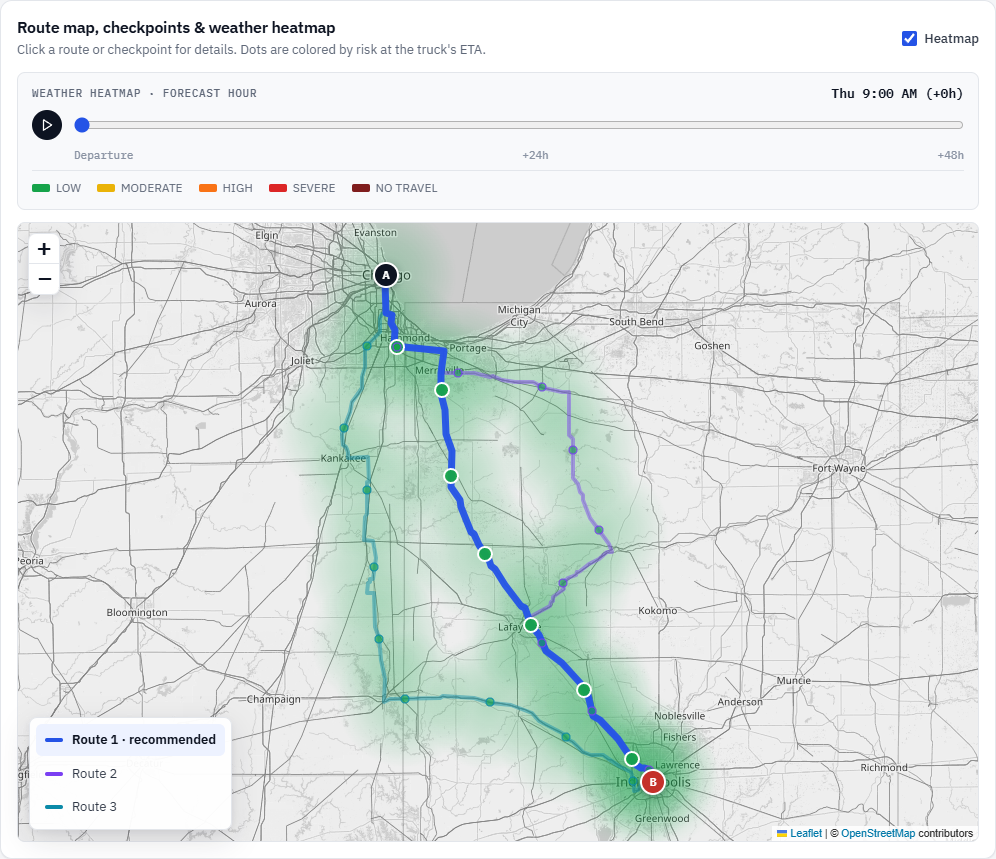
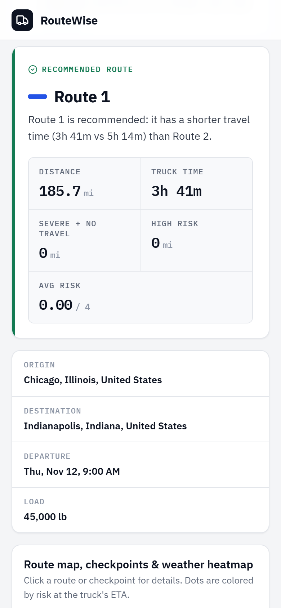
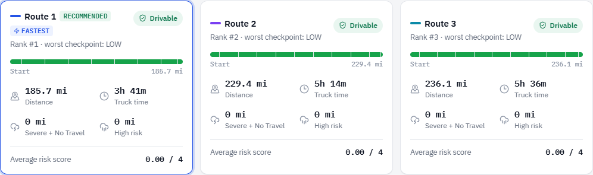

# RouteWise · Weather-Aware Truck Routing

React + TypeScript + Django REST app that helps a truck driver choose the safest route. It compares up to three truck routes by **weather risk at the moment the truck reaches each checkpoint**, adjusts that risk for the **load weight**, recommends the best route with a plain-English reason, and shows a **0–48 h weather heatmap** along the corridor.

## Requirements coverage

| Brief | Implementation |
|---|---|
| Origin, destination, departure, load | Search-as-you-type places (exact coordinates), date/time, load in lb, checkpoint interval |
| 3 route options from a routing API | OpenRouteService **truck (HGV) profile** with OSRM fallback; extra distinct routes via side via-points when the router returns fewer |
| Weather every 10 / 25 / 50 mi at the truck's ETA | Checkpoints at mile 0, every interval and the destination; each uses the forecast hour nearest its ETA |
| Risk + load rules | Exactly the brief's table (below); worst of wind / rain / snow |
| Recommend, balancing risk and time | Brief's order with an explicit 0.05 average-risk tie band so time can decide; reason shown in the UI |
| Routes, checkpoints, risk, ETAs, summaries on a map | Colour-matched routes + legend, risk-coloured checkpoint dots with popups, route cards, linked checkpoint table |
| Heatmap along the corridor, 0–48 h slider | Client-side canvas heatmap, continuous slider + Play, blended between hours, 60 fps |

## How it works

1. **Places.** Origin and destination come from Photon autocomplete (OpenStreetMap data, limited to the US/Canada/Mexico by `GEOCODE_COUNTRIES`), so exact coordinates reach the API.
2. **Routes.** With `ORS_API_KEY`, OpenRouteService's heavy-goods-vehicle profile returns routes using truck speeds and weight limits for the **gross** weight (cargo + `TRUCK_EMPTY_WEIGHT_LB`, default 35,000 lb). Without a key, or if ORS fails, OSRM's car profile is used and the result says so. If the router returns fewer than 3 routes, extra candidates are requested through via-points pushed sideways from the main route (mid-route, then ⅓ and ⅔, then a wider offset; both sides; each round in parallel). A candidate is kept only if it is ≤ 1.5× the main route's length (+10 mi) and its mean separation from every kept route is > 1.5 mi.
3. **Checkpoints.** Each route is sampled at mile 0, every 10/25/50 mi and at the destination. Each checkpoint carries `segment_miles` (the road it represents), so risk miles are distance-weighted and add up to the route length.
4. **ETA.** Departure + route duration × distance fraction. Duration is never faster than a truck average of `TRUCK_AVG_SPEED_MPH` (default 55), which matters when the car-profile fallback is used.
5. **Weather.** All locations are de-duplicated and fetched in batched Open-Meteo requests (cached 15 min). Checkpoints use their **exact location** (~1 km); heatmap-only points share a 0.1° (~7 mi) grid. Rain is `rain + showers` (total precipitation would count snow water as rain); units are read from the API's `hourly_units`.
6. **Risk, summaries, ranking** as described below.
7. **Heatmap.** A risk score for each of the 49 hours after departure at points along all routes (the checkpoints themselves, or ~25 mi spacing, widened on very long trips to ≤ 80 extra points per route). The slider is purely client-side: it moves continuously, Play animates frame by frame, colours blend between forecast hours, and the canvas follows Leaflet's zoom animation. Route layers are memoised, so playback only repaints the heat canvas.

## Risk rules

| Condition | Low | Moderate | High | Severe | No Travel |
|---|---|---|---|---|---|
| Wind (mph) | < 25 | 25–34 | 35–44 | 45–54 | ≥ 55 |
| Rain (in/hr) | < 0.10 | 0.10–0.25 | 0.25–0.50 | 0.50–1.00 | > 1.00 |
| Snow (in/hr) | < 0.5 | 0.5–1.0 | 1.0–2.0 | 2.0–3.0 | > 3.0 |

**Load rules (wind):** ≥ 55 mph → No Travel for any load · 45–54 mph and > 30,000 lb → No Travel · 35–44 mph and > 40,000 lb → Severe.

A checkpoint's level is the **worst** of its wind, rain and snow levels (scores 0–4). Implemented in [`risk_calculator.py`](backend/routing/risk_calculator.py) and tested at every boundary.

**Interpretation of the brief**
- A value exactly on a boundary belongs to the higher category (wind 25 = Moderate, 35 = High, 45 = Severe, 55 = No Travel; rain 0.25 = High). Rain > 1.00 and snow > 3.0 are No Travel, so exactly 1.00 / 3.0 is Severe.
- Load thresholds are strict (`> 30,000`, `> 40,000`) and apply to wind only. The load is the cargo weight entered by the user.
- Wind is the sustained 10 m wind speed (gusts would be a stricter option).

## Recommendation logic

Each route gets a distance-weighted summary: **Severe miles** (which include No Travel miles), **No Travel miles**, **High miles**, **average risk score** (0–4) and **truck time**. Routes are ranked in the brief's order:

1. **No Travel miles** first, so a route through a No Travel zone never beats a drivable one
2. fewest **Severe** miles
3. fewest **High** miles
4. lowest **average risk**, where routes within **0.05** of the best count as equally risky
5. shortest **travel time**

Average risk is a continuous number. Compared strictly, a 0.01 difference would outweigh hours of extra driving, so the 0.05 band lets travel time decide between routes that are equally risky in practice. Severe and High miles are never traded for time. The API returns a plain-English `recommendation_reason` (for example, "Route 2 is recommended: it has 12.5 mi fewer severe miles than Route 1."). If every route crosses No Travel, the UI says **"Do not depart as planned"**.

## Screenshots

| Map, checkpoints & heatmap | Phone |
|---|---|
|  |  |



## Run locally

Requires Python 3.12+ and Node 20+. No configuration is needed: without `DJANGO_SECRET_KEY` the backend runs in DEBUG mode with the keyless providers (OSRM, free Open-Meteo).

```bash
# Backend (macOS/Linux)
cd backend && python -m venv .venv && source .venv/bin/activate
pip install -r requirements.txt
python manage.py runserver            # http://127.0.0.1:8000

# Frontend
cd frontend && npm install && npm run dev   # http://localhost:5173
```
Windows PowerShell backend: `py -3 -m venv .venv; .\.venv\Scripts\Activate.ps1; pip install -r requirements.txt; python manage.py runserver`

For truck routing, create `backend/.env` with `ORS_API_KEY=<your key>` (free at [openrouteservice.org](https://openrouteservice.org)). The header shows which routing service is active.

## Configuration

Backend environment variables (`backend/.env` or the host's dashboard; see [`backend/.env.example`](backend/.env.example)):

| Variable | Default | Purpose |
|---|---|---|
| `DJANGO_SECRET_KEY` | dev key | Required in production; when set, DEBUG defaults to off |
| `DJANGO_DEBUG` | on locally, off with a secret key | Override debug mode |
| `DJANGO_ALLOWED_HOSTS` | localhost | API hostnames (Render's hostname is added automatically) |
| `CORS_ALLOWED_ORIGINS` | localhost:5173 | Frontend origin(s) |
| `ORS_API_KEY` | – | Enables OpenRouteService truck (HGV) routing |
| `TRUCK_EMPTY_WEIGHT_LB` | 35000 | Added to the cargo for the router's weight limits |
| `TRUCK_AVG_SPEED_MPH` | 55 | Truck speed cap for ETAs |
| `OPEN_METEO_API_KEY` | – | Commercial Open-Meteo endpoint (no free-tier limits) |
| `GEOCODE_COUNTRIES` | us,ca,mx | Countries allowed in place search; empty = worldwide |
| `ANALYZE_RATE_LIMIT` / `PLACES_RATE_LIMIT` | 15/min / 60/min | Per-IP request limits |

Frontend: `VITE_API_BASE_URL` (default `http://127.0.0.1:8000`).

## Tests & quality

```bash
cd backend && python manage.py test     # 43 tests
cd frontend && npm run check            # ESLint, Prettier check, 12 Vitest tests, type-check, build
```

- **Backend tests** cover every threshold boundary, all load rules, distance-weighted summaries, ranking and its tie band, No Travel handling, sampling geometry, route generation (truck router, fallbacks, via-points), unit conversion, rate-limit handling, place search and a mocked end-to-end analysis.
- **Frontend tests** cover the heatmap's hour blending, colour scale and formatting.
- **Isolation:** tests never use real API keys or the network.
- **CI:** GitHub Actions ([`ci.yml`](.github/workflows/ci.yml)) runs everything on every push.
- **Browser check:** verified in headless Chrome with 60 fps heatmap playback, no long tasks, no console errors, and no horizontal overflow at 390 px.

## Deploy

- **Backend (Render / Railway / Fly):** root directory `backend`, build `pip install -r requirements.txt`, start via `Procfile` (gunicorn). The Python version is pinned in `backend/.python-version`. Set `DJANGO_SECRET_KEY`, `CORS_ALLOWED_ORIGINS`, `ORS_API_KEY` and optionally `OPEN_METEO_API_KEY`.
- **Frontend (Vercel / Netlify):** root directory `frontend`, build `npm run build`, output `dist`, env `VITE_API_BASE_URL=https://<your-api-host>`.

## API

`GET /api/places/?q=Indianap` → `{"results": [{"display_name", "lat", "lon"}, …]}` (up to 5; at least 3 characters)

`POST /api/analyze/`
```json
{ "origin": { "display_name": "Chicago, Illinois, United States", "lat": 41.8756, "lon": -87.6244 },
  "destination": { "display_name": "Indianapolis, Indiana, United States", "lat": 39.7683, "lon": -86.1584 },
  "departure_time": "2026-11-12T08:00:00-06:00",
  "load_weight_lb": 25000, "checkpoint_interval_miles": 25 }
```
Departures are accepted from 24 h in the past to 4 days ahead (the forecast window). The response contains `routes[]` (geometry, checkpoints with ETA / forecast hour / weather / per-factor risk, summary, rank, flags), `recommendation`, `recommendation_reason`, `all_routes_blocked`, `routing_provider` (`ors-hgv` or `osrm-car`), `heatmap {start_time, hours, spacing_miles, points[{lat, lon, scores[49]}]}` and `notices[]`.

`GET /api/health/` → `{"status": "ok", "routing": "OpenRouteService HGV" | "OSRM (car)", "weather": "Open-Meteo"}`

Errors are always `{"error": "…"}`:

| Status | Meaning |
|---|---|
| `400` | invalid input |
| `422` | impossible trip (e.g. no road between the places) |
| `429` | too many requests |
| `502` | upstream failure |
| `503` | weather service rate-limited (with `Retry-After`) |

## Project structure

```
backend/
  config/settings.py          env-driven settings, rate limits
  routing/risk_calculator.py  risk rules, route summaries, ranking + reason (pure Python)
  routing/services.py         one analysis: routes -> checkpoints -> ETAs -> weather -> risk -> heatmap
  routing/providers.py        Photon, Nominatim, OpenRouteService, OSRM, Open-Meteo clients (+ caching, fallbacks)
  routing/geometry.py         sampling, distances, simplification, route separation
  routing/views.py            REST endpoints, error mapping, throttling
  routing/tests.py            backend test suite
frontend/src/
  App.tsx                     page layout, recommendation, checkpoint table
  components/RouteMap.tsx     Leaflet map, routes, checkpoints, legend, focus
  components/HeatLayer.tsx    canvas heatmap (blending, zoom animation)
  components/HeatmapControl.tsx  slider + Play
  components/TripForm.tsx, LocationAutocomplete.tsx, RouteCard.tsx
  riskColors.ts, format.ts    shared colours, blending and formatting (unit-tested)
docs/WALKTHROUGH.md           script for the video walkthrough
```

## Limitations

- **Truck restrictions:** the HGV profile enforces **weight** limits. Height, length and hazmat aren't checked because the brief's inputs don't include them (ORS supports them via `profile_params.restrictions`). The OSRM fallback is a car router and checks no truck restrictions; the UI states which router was used.
- **Free public services** (OpenRouteService, OSRM, Photon, Nominatim, Open-Meteo, OpenStreetMap tiles) have usage limits. They're fine for a demo and review traffic, but production needs paid plans. To protect them, the API rate-limits each IP and caches aggressively.
- **Open-Meteo free tier:** it counts every location as one call (600/min, 5,000/h, 10,000/day per IP), so very long trips at 10-mile spacing can hit the per-minute limit. The backend then retries, falls back to cached forecasts up to 3 h old (with a notice), or returns a clear 503. Set `OPEN_METEO_API_KEY` to avoid this.
- **ETAs** are proportional estimates and ignore traffic, breaks and hours-of-service rules.
# weather-truck-routing
